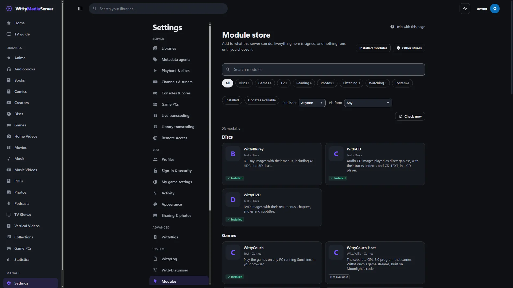
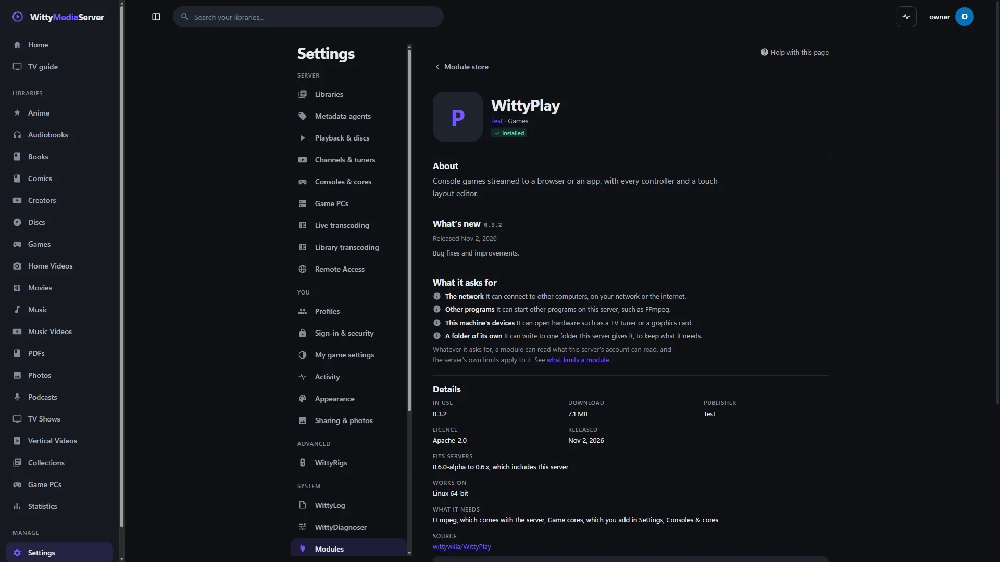

# WittyModule

What a WittyMediaServer plugin needs to be a project of its own: the manifest, the rules for version ranges, the protocol a helper process speaks, and the tool that builds and signs a release. It's for people who make modules.

<!-- pictures -->



<sub>What a module becomes: its entry in the store, here from a local test catalogue.</sub>



<sub>A module's own page in the store.</sub>

<!-- /pictures -->

## What it does

- **The manifest:** `module.json`, parsed and checked here.
- **Version ranges:** which servers a version fits.
- **The helper protocol:** what a helper program and a server say to each other. A helper is a small program:

```go
func main() {
	wittymodule.Main(manifestJSON, func(method string, params json.RawMessage) (any, []byte, error) {
		// answer one call
	})
}
```

- **The catalogue:** the code that reads and checks a store's signed list of modules.
- **Withdrawing a version:** the signed list that takes a version back.
- **The `wittymodule` tool:**

| Command | What it does |
|---|---|
| `check` | Checks a folder's manifest |
| `pack` | Builds a release: a program for every system, or a browser bundle with `-web` |
| `sign`, `keygen` | Signs a checksum list, and makes a key |
| `bump`, `needs-bump` | Raises the version everywhere it's written, and fails if code changed since the last tag with no new version |
| `withdraw`, `restore` | Takes a version back, and undoes that |
| `catalog-add`, `catalog-check`, `catalog-sign` | Works on a store's catalogue |

- **`kit/`:** `kit/module-kit.sh` writes a module's workflows and the Releasing section of its README, and `kit/facade` writes the stubs a server uses to call a module.

The design, including what each version range means, is in Making a module, in **Help** inside WittyMediaServer.

## How to get it

Modules bring it in as a Go dependency:

```bash
go get github.com/wittywilla/wittymodule
```

```bash
go run github.com/wittywilla/wittymodule/cmd/wittymodule check .
```

A server gets it inside the modules built with it, so there's nothing to add from the store. Modules built with this version work with WittyMediaServer 0.6.0-alpha or later, through **Settings → Modules**, and nothing older.

## What it needs

Go 1.26 or newer. It has no dependencies, and no cgo.

## Platforms

It's plain Go, and CI builds it for Windows, macOS, Linux and FreeBSD. Its tests have been run on Linux, and `pack` has built modules for all four from there, including FreeBSD on amd64 and arm64. Those have not been run on a real Mac or on FreeBSD. `kit/module-kit.sh` needs bash.

## Building and testing

```bash
go vet ./...
```

```bash
go test ./... -count=1
```

```bash
go run ./cmd/wittymodule check .
```

A module's own `pack` and `sign` go like this:

```bash
go run github.com/wittywilla/wittymodule/cmd/wittymodule pack -out release .
```

```bash
go run github.com/wittywilla/wittymodule/cmd/wittymodule sign release/<id>-<version>-SHA256SUMS.txt
```

To make or refresh a module's workflows:

```bash
kit/module-kit.sh ../WittyPhotos
```

## Licence

GNU Affero General Public License v3.0 (or later): see [LICENSE](LICENSE) and [NOTICE](NOTICE). If you redistribute it or build on it, please keep the NOTICE attribution.

## Legal

WittyModule is an independent open-source project. It isn't associated with, sponsored by or
endorsed by any publisher, rights holder, service or other media software project. A module built
with it comes from whoever published that module. Any third-party names here only describe what it
works with, and belong to their owners. It's provided “as is”, with no warranty; see
[LICENSE](LICENSE). Local law applies to how you use it. This isn't legal advice.

<!-- module-kit -->
## Releasing

WittyModule reaches a server inside the projects built with it, so a release has no files of its own: a version tag runs the tests and publishes a release that those projects can require.

Versions move in small steps as work lands. `go run github.com/wittywilla/wittymodule/cmd/wittymodule@v0.3.0 bump .` raises it
everywhere it is written (add `-part minor` for a bigger step). A bump isn't a release: nothing is
tagged or published until you tag it. CI fails when code changed since the last tag and the version
didn't, because tags never move.

To release:

1. Check that `version` in `module.json` is the one to publish, with the bump committed.
2. Tag that commit and push the tag: `git tag vX.Y.Z`, then `git push origin vX.Y.Z`. A tag with a
   suffix, such as `v1.2.0-beta`, is published as a prerelease.
3. Watch the *Actions* tab. There is nothing to sign.

Licensed under AGPL-3.0-or-later: see [LICENSE](LICENSE) and [NOTICE](NOTICE).
<!-- /module-kit -->
